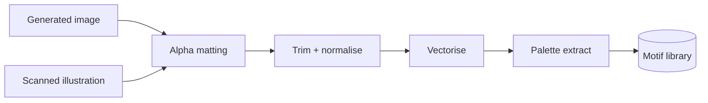
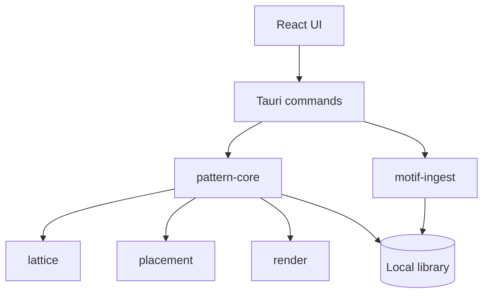

# Patternated — Technical Spec

_As of 20 September 2026._

## Purpose and scope

Build a deterministic repeat-pattern engine that turns a library of illustrated
motifs into print-ready textile patterns, seamless by construction rather than by
seam-fixing.

The engine composes patterns from **individual motifs** (one banana, one dinosaur),
not from square pattern images. Motifs arrive from three sources — hand
illustrations scanned or exported by a designer, generated images of single objects
on flat backgrounds, and previously ingested motifs from the library. All three take
the identical path through the pipeline, because a motif is just a file with an
alpha channel and a palette.

Two consumers share the engine, and their differences drive most of the design
decisions below.

|  | Peel Club | Dreamwoven |
| --- | --- | --- |
| Product | Adult apparel, fruit prints | Bespoke children's pyjamas |
| Motif source | One designer's illustrations | Generated per order from a child's interests |
| Subjects | Fixed, curated | Arbitrary and unpredictable |
| Batch | A range, printed at volume | One garment, one customer |
| Human in the loop | Designer approves every print | Nobody |
| Style coherence | Guaranteed by the illustrator | Must be enforced by the system |
| Maturity | Live, illustrations exist | Concept |

The second column is the harder engineering problem and the better commercial bet,
but Peel Club is real today. Build for Peel Club, design the seams so Dreamwoven
slots in without rework.

What this is not:

- Not a diffusion model that generates patterns. Generative models have no concept
  of a torus and cannot control repeat structure or physical scale. They generate
  motifs here, never layouts.
- Not a seam-fixing tool for broken patterns. Nothing here ever produces a seam to
  fix.
- Not a general design tool. It does one job: motif library in, coordinated print
  out.

Success for v0 is a season of coordinated Peel Club prints produced from the
existing illustrations, at print spec. Productisation as a tool for other designers
is a later and separate question, and a doubtful one — see the closing note under
Out of scope.

## Core model

A repeat is a **lattice** plus a set of motif placements on a **torus**. Everything
else in the engine is a consequence of those two ideas.

The lattice is two translation vectors, **u** and **v**. Copies of the tile sit at
every integer combination of them:

```latex
P_{ij} = P + i\,\mathbf{u} + j\,\mathbf{v}, \qquad i, j \in \mathbb{Z}
```

Every named textile repeat is just a choice of **u** and **v** over a tile of width
W and height H:

| Repeat | u | v | Notes |
| --- | --- | --- | --- |
| Block (straight) | (W, 0) | (0, H) | Orthogonal lattice; shows obvious rows and columns |
| Half-drop | (W, H/2) | (0, H) | Oblique lattice; commercial default for organic motifs |
| Brick (half-brick) | (W, 0) | (W/2, H) | Horizontal stagger; suits geometrics and stripes |
| Quarter-drop | (W, H/4) | (0, H) | Gentler diagonal flow than half-drop |
| Mirror | (2W, 0) | (0, 2H) | Tile reflected in x and y within a 2×2 super-tile |

> **Built differently.** Mirror is not a lattice at all, and doubling the tile
> would make the repeat size a consequence of construction. What was built
> reflects placements *within* the tile the designer asked for, leaving the
> lattice block. See
> [Decisions](./decisions.md#a-mirror-is-a-symmetry-of-the-tile-not-a-lattice).

Half-drop is the workhorse because the vertical stagger disrupts **tracking lines** —
the accidental diagonal or vertical corridors the eye finds when motifs align across
tiles. Tracking is the single most common reason an amateur pattern reads as
amateur, and the engine should treat it as a measurable defect, not a matter of
taste.

Two data types carry the whole model:

1. `Lattice { u: Vec2, v: Vec2 }` — expressed in physical units (mm), never pixels.
2. `Placement { motif_id, position: Vec2, rotation: f32, scale: f32, palette_slot: u8 }`
   — position in tile-local coordinates, always within [0, W) × [0, H).

A pattern is
`{ tile_size_mm: Vec2, lattice: Lattice, placements: Vec<Placement>, palette: Palette }`.
That struct is the entire serialisable document format. It is small, diffable, and
can be regenerated at any resolution — which matters, because the same pattern must
render as a 200 px web thumbnail and a 4 m print run from one source of truth.

## Tiling algorithm

Seamlessness is guaranteed by construction: every motif is rendered nine times, once
at its own position and once at each of the eight lattice-neighbour offsets. Any
motif overlapping a tile edge therefore also appears, correctly clipped, on the
opposite edge.

```
for placement in placements:
    for (i, j) in [-1, 0, 1] × [-1, 0, 1]:
        offset = i * lattice.u + j * lattice.v
        draw(placement.motif, placement.position + offset)
clip to [0, W) × [0, H)
```

Three properties follow, and they are the whole argument for the deterministic
approach:

- **No blending, no seam repair, no edge detection.** The tile is correct on the
  first render.
- **Exactness.** The result is identical at any output resolution, because
  placements are physical coordinates resolved at render time.
- **Reversibility.** A pattern can be edited motif-by-motif after the fact. Nothing
  is baked in.

One correctness note for oblique lattices. With a half-drop the neighbour set is not
a naive ±W, ±H grid — the offsets must come from **u** and **v** themselves, as
above. Hardcoding (±W, ±H) produces a pattern that tiles correctly in a preview grid
and fails on the printer, which is an expensive way to find the bug.

Rendering should happen twice, at different fidelities:

| Stage | Purpose | Resolution | Target |
| --- | --- | --- | --- |
| Preview | Live editing, 3×3 repeat view | 72–96 DPI equivalent | GPU or fast CPU raster |
| Export | Production output | 150–300 DPI at physical tile size | CPU, quality-first, vector where possible |

The 3×3 preview matters more than it sounds. A single tile tells you nothing about
tracking; three-by-three is the minimum at which the eye can spot corridors, and
designers will judge the tool on whether that view is instant.

## Motif pipeline

This is the hard half of the engine. The tiling maths is a day's work; getting
clean, recolourable, scalable motifs out of arbitrary source art is most of the
build.

Three entry points, one pipeline. Generated motifs are not a special case — they are
an image like any other, and the moment they hit matting the origin stops mattering.



**Generation** applies to Dreamwoven only. One subject per image, isolated on a flat
background — the single thing image models do reliably. Never ask for a pattern, a
scene, or several objects at once. Generation is also the only stage needing a
network call, which is why it sits outside `pattern-core` and behind a trait, so it
can be swapped or stubbed.

**Alpha matting.** Cut the object from its background with a soft, accurate edge.
Background-removal models of the BiRefNet or SAM class handle this well, and matting
quality is what separates a motif that prints cleanly from one with a grey halo.
Hand illustrations on white paper can often skip the model entirely: a luminance
threshold with edge feathering is faster and more faithful.

**Trim and normalise.** Crop to the alpha bounding box, record the motif's natural
aspect ratio, and store a physical reference size in mm so scale is meaningful
before any placement happens.

**Vectorise.** Trace to paths so the motif prints crisply at any size. `vtracer` is
the pragmatic choice — Rust-native, colour-aware, no C++ build chain. Keep the
raster alongside the vector: some illustration styles (watercolour, texture, grain)
vectorise badly and should stay raster with a high-DPI original.

**Palette extract.** Quantise the motif to a small set of flat colours and store
them as indexed **palette slots** rather than literal values. This one decision is
what makes colourways possible later, and retrofitting it is painful — build it in
from the first commit.

Motifs are immutable once ingested. Re-ingesting produces a new version rather than
mutating the old one, so existing patterns never change underneath a designer who
has already approved them.

## Style coherence

This section exists entirely for Dreamwoven. Peel Club gets coherence free, because
one illustrator draws everything.

The problem: generate a dinosaur, an ice cream and a football in three separate
calls and you get three different illustrators. Different line weights, different
levels of detail, different lighting, different palettes. On a garment that reads as
a clip-art collage, which is the opposite of the special object a parent is paying
for.

Four mechanisms, in rough order of effectiveness:

1. **A fixed style adapter.** A LoRA or style-reference image trained on one
   consistent illustration style, applied to every generation. Dreamwoven needs its
   own reference set, built from scratch; Peel Club's assets are not available to
   it, for the reason set out below.
2. **Forced palette normalisation.** Quantise every motif onto one shared palette at
   ingest rather than preserving its generated colours. This costs nothing extra,
   since the palette-slot machinery already exists for colourways, and it does a
   surprising amount of the work — much of perceived style mismatch is really colour
   mismatch.
3. **Silhouette and detail normalisation.** Enforce a target path count and stroke
   weight at vectorisation. A dinosaur rendered with 400 paths next to a football
   with 12 will never sit right.
4. **Rejection and retry.** Score each generated motif against the style reference
   and regenerate below a threshold. Cheap to run, and the only mechanism that
   catches a genuinely off output.

Mechanism 2 should be built regardless, since Peel Club benefits too. The rest are
Dreamwoven-only and belong after M4.

Dreamwoven and Peel Club are separate brands with no shared visual identity. Peel
Club's illustrations are therefore unavailable as a style primer, notwithstanding
that their IP was acquired outright and the position is clean. The two brands share
the engine, the palette machinery and the pipeline; nothing visual crosses between
them.

Dreamwoven consequently needs its own style reference, built from nothing. That is a
real cost on a concept-stage product and it gates all of M7.

The compensation is that style becomes a brand decision taken with the technical
constraint in hand, which Peel Club never had the chance to do. The constraint:
**pick an idiom engineered to generalise**, because illustration styles differ
enormously in how well they transfer across arbitrary subject matter.

| Idiom | Portability | Why |
| --- | --- | --- |
| Flat vector, geometric simplification | High | Subject reduces to shape and colour; a dinosaur and an ice cream resolve to the same visual grammar |
| Bold outline, flat fill (sticker) | High | Outline weight carries the style independently of what is inside it |
| Chunky gouache or crayon texture | Medium | Texture transfers; proportion and detail level drift between subjects |
| Fine linework, painterly, watercolour | Low | Style lives in subject-specific detail; coherence collapses across unlike objects |

The top two rows are also the idioms most heavily represented in children's product
design, so the constraint and the brand instinct point the same way.

The commission is a definition exercise rather than a demonstration one. Write the
style down explicitly first — line weight, fill treatment, level of abstraction,
outline or none, how shading and highlights work, palette rules — then commission
roughly 20 reference pieces against that written spec, spanning an animal, a
vehicle, a food, a plant, a manufactured object and a figure.

The written style guide is the more valuable of the two artefacts. It governs prompt
construction, vectorisation normalisation and palette rules as well as the adapter,
and it outlives whatever generation model is current in two years.

Start with reference-image conditioning (IP-Adapter and similar) rather than a
trained LoRA — fewer references needed, no training step, faster to iterate. Move to
a LoRA only if conditioning proves too weak.

Bootstrap the style before commissioning anything. Flat vector children's
illustration is heavily represented in model training data, so generating candidate
exemplars, picking the strongest and using those as the reference image costs
nothing and tests the whole approach. Commission properly only once that has shown
the adapter holds across a dinosaur, a rocket and an ice cream in one garment. For a
pre-revenue concept this keeps Dreamwoven's outlay at zero until it has earned an
illustration budget.

## Placement and layout

The lattice decides structure; placement decides whether the pattern looks designed
or generated. Two families, and the second is where the value sits.

**Structured placement** puts one or a few motifs at fixed points in the tile and
lets the lattice do the work. Cheap, predictable, and correct for foulards, spot
patterns and geometrics. Parameters are motif choice, position, rotation and scale.

**Scatter (tossed) placement** distributes many motifs across the tile to read as
hand-strewn. Naive uniform random sampling always fails: it clumps, leaves bald
patches, and produces tracking lines. The fix is **Poisson-disc sampling on a torus**
(Bridson's algorithm), which guarantees a minimum separation `r` between every pair
of points while keeping the distribution irregular.

The toroidal detail is essential and easy to get wrong. Distance between two points
must wrap:

```latex
d(\mathbf{a}, \mathbf{b}) = \left\| \left( \left| a_x - b_x \right| \bmod W,\ \left| a_y - b_y \right| \bmod H \right) \right\|
```

taking the shorter path in each axis. Sample with Euclidean distance instead and
motifs collide across the tile boundary — invisible in a single tile, obvious in the
3×3 view.

Around that core, four controls a designer will expect:

1. **Density** — target coverage as a percentage of tile area. Solve for `r` from
   coverage and mean motif area rather than exposing `r` directly; nobody thinks in
   minimum separation radii.
2. **Rotation jitter** — a bounded random rotation per placement. Fruit reads badly
   when every banana points the same way, and badly again when rotation is fully
   uniform.
3. **Scale variation** — a bounded multiplier, typically 0.8 to 1.2. Small amounts
   of it do a disproportionate amount of work.
4. **Motif mix** — relative weights across the library, so a print can be 60%
   cherries and 10% pineapples.

**Tracking detection** is a first-class feature, not an afterthought. Render the 3×3
field to a low-resolution mask, run a Radon or Hough transform over it, and flag any
direction with anomalously high energy. For Peel Club it surfaces as a warning with
a one-click reseed. For Dreamwoven it is a **blocking gate**: no designer sees the
output, so the check either passes or the pattern is regenerated with a new seed,
automatically, before anything reaches fabric. No competing tool does this well, and
it is exactly the kind of check a deterministic engine can make and a diffusion
model cannot.

Every generation is seeded. The same seed with the same parameters must produce a
byte-identical pattern, so a designer can return to a print months later and
reproduce it exactly.

## Colourways

A colourway is the same pattern in a different palette. Textile ranges sell in
colourways, so this is not a nice-to-have — it is half of what the tool is for.

The mechanism follows from the palette-slot decision in the motif pipeline. Motifs
store slot indices, not colours. A `Palette` is an ordered list of colours;
rendering resolves slot → colour at draw time. Swapping the palette recolours every
motif in the pattern consistently, in one operation, with no re-ingestion.

```latex
\text{render\_colour}(m, s) = \text{Palette}[\,\text{slot}(m, s)\,]
```

Three capabilities on top of that:

- **Named house palettes.** Peel Club's brand colours stored once and applied across
  a whole range, so prints coordinate by construction.
- **Palette generation.** Derive variants from a base palette by rotating hue,
  shifting lightness, or swapping figure and ground. Useful for producing four
  candidate colourways in a second and picking one.
- **Ground colour as a slot.** The background is slot 0, not a special case.
  Inverting a print to a dark ground then costs nothing.

One constraint worth honouring early: **screen printing charges per colour**. A
pattern that resolves to five slots is cheap; one that resolves to twenty is not
printable by that method at all. Show the resolved colour count in the UI at all
times, and let a designer set a maximum that the palette generator respects. Digital
printing has no such limit, but knowing which route a print is taking changes the
design.

> Open question: confirm whether Peel Club is heading for digital or screen
> printing. This decides how hard the colour-count limit bites.

## Output and print readiness

The engine works in millimetres throughout and converts to pixels only at export.
Pattern scale is a physical property — a 12 cm repeat and a 40 cm repeat are
different designs, not different zoom levels — and tools that model scale in pixels
force the designer to do the conversion arithmetic themselves, every time.

```latex
\text{pixels} = \frac{\text{millimetres}}{25.4} \times \text{DPI}
```

Repeat scale must derive from garment size, not be set once and reused. A 24 cm
repeat reads completely differently on an adult shirt, a nine-year-old's pyjama leg
and a three-year-old's. For Dreamwoven this has to be automatic — age maps to a size
chart, the size chart sets a scale factor on both the tile and the motifs within it —
or a small garment ships with one enormous dinosaur and a great deal of background.
Peel Club needs the same mechanism across its size range, just with a human able to
override it.

Export targets:

| Format | Colour | Use |
| --- | --- | --- |
| PNG, embedded DPI | RGB | Digital fabric printing, web, mockups |
| TIFF, embedded ICC | CMYK | Commercial print, bureau submission |
| SVG | RGB | Vector workflows, Illustrator handoff, infinite scaling |
| Per-colour TIFF set | Separated | Screen-printing separations, one file per slot |

Three things to get right, in order of how often they cause reprints:

1. **Colour management.** Convert RGB to CMYK through a real ICC profile, not a
   naive formula, and soft-proof in the UI. "It looked different on screen" is the
   most common complaint in fabric printing, and it is almost always an unmanaged
   conversion.
2. **DPI and physical size in every file.** Embed the DPI, and name exports with the
   repeat size — `peelclub-cherries-halfdrop-240mm-150dpi.tif` removes an entire
   category of mistakes.
3. **Bleed.** Some bureaux want the tile alone, some want bleed. Make it a toggle
   and state the convention in the export dialog.

A garment mockup renderer is worth building early despite looking cosmetic. Seeing a
print at true scale on a shirt is how a scale error gets caught before fabric is
bought, and it is the fastest way for two people to agree on a design without
printing anything.

Open question: confirm the target printer's spec before building the export layer,
since DPI expectations and colour handling vary by bureau and the wrong assumption
here is invisible until a sample arrives.

## Constraints by brand

Peel Club's constraints are all engineering ones, covered above. Dreamwoven adds
three that are not, and two of them can stop the business rather than merely degrade
the output.

### Unattended quality gates

With no human approving each order, every check becomes automatic and blocking. A
gate that fails triggers a reseed and a retry; a gate that fails repeatedly triggers
a human. Minimum set:

| Gate | Fails when | Action |
| --- | --- | --- |
| Tracking | Directional energy above threshold in the 3×3 field | Reseed |
| Coverage | Density outside the target band | Reseed |
| Motif scale | Motif exceeds a fraction of garment panel width | Rescale, then reseed |
| Colour count | Resolved slots above the print method's limit | Re-quantise palette |
| Style score | Generated motif below similarity threshold | Regenerate that motif |

### Intellectual property

The highest commercial risk in Dreamwoven. A six-year-old's favourite things are, in
practice, largely licensed characters, and none of them can be printed. Expect this
on a large share of orders rather than as an edge case.

Mitigations, layered:

- **Guided input over free text.** Offer categories and subjects rather than an open
  box. This shapes expectations before a parent types a character name, and is the
  single most effective control.
- **A blocklist**, covering character names, franchises and common misspellings,
  checked before generation.
- **A model-side check** on the generated motif, since a prompt can describe a
  protected character without naming it.
- **A graceful redirect.** "A blue cartoon dog" is fine; the named character is not.
  Say so in a way that keeps the order alive.

### Nightwear regulations (UK)

Not legal advice — confirm with someone who does this properly before selling. The
shape of it:

- Children's nightwear generally must meet the flammability performance requirements
  of BS 5722, but pyjamas are among the listed exceptions, along with cotton
  terry-towelling bath robes and garments for babies under three months.
- Pyjamas must still be **labelled** to tell the buyer whether or not the fabric
  meets those requirements. If it does not, the label must read 'KEEP AWAY FROM
  FIRE' in red.
- For online and mail-order sales, where the garment does not meet the requirements,
  that same wording has to appear next to the listing inside a red-sided equilateral
  triangle. This is a constraint on the shop front, not just the garment.
- BS EN 14878 is recommended for children's pyjamas so suppliers meet their General
  Product Safety Regulations obligations.
- UK REACH restricts certain azo dyes and flame retardants, which bears directly on
  a printed product — worth raising with the print bureau early.

Source: <https://www.businesscompanion.info/en/quick-guides/product-safety/new-nightwear>

Fabric choice interacts with all of the above. Jersey is the obvious pyjama
substrate and it stretches, which distorts a print, so the repeat may need
compensating before it goes to the printer.

## Architecture and stack

Tauri 2, with a Rust core and a React/TypeScript shell. Local-first: motifs and
patterns live on disk, nothing is uploaded. That is both the right engineering
choice and a real selling point later, since designers are reluctant to upload
unreleased artwork to a web tool.



Crate boundaries, chosen so the core stays free of any dependency on the app shell:

| Crate | Responsibility | Key dependencies |
| --- | --- | --- |
| `pattern-core` | Lattice, placement, tiling, colourways. Pure, no I/O | `glam`, `rand_chacha` |
| `pattern-render` | Raster and vector rendering at any DPI | `tiny-skia`, `resvg` |
| `motif-ingest` | Matting, trimming, vectorising, palette extraction | `image`, `vtracer` |
| `pattern-io` | Export, colour management, file naming | `lcms2`, `tiff` |

`pattern-core` must have no I/O and no async. It is a pure function from parameters
to placements, which makes it trivially testable, trivially fast, and the natural
thing to expose as an API later without rewriting anything.

Use `rand_chacha` rather than the default RNG. Reproducibility depends on the
generator being stable across versions and platforms, and the standard one offers no
such guarantee.

The API question answers itself if the core is kept pure: a pattern is a small JSON
struct, so a service is a thin HTTP layer over `pattern-core` plus `pattern-render`.
Worth designing for, not worth building yet.

## Build order

Each milestone ends in something usable. Nothing here requires the milestone after
it.

**M1 — Bare engine.** `pattern-core` plus `pattern-render`, driven by a JSON file
and a CLI. Block and half-drop lattices, structured placement, PNG output. Test: a
hand-placed cherry tiles seamlessly in a 3×3 render. This is the milestone that
proves the whole approach, and it is small.

**M2 — Scatter.** Toroidal Poisson-disc sampling, density, rotation jitter, scale
variation, motif mix, seeded reproducibility. Test: a 40-motif scatter shows no
clumps, no bald patches, and no visible corridors at 3×3.

**M3 — Motif ingest.** Matting, trim, vectorise, palette extraction, local library.
Test: the existing Peel Club illustrations go in unmodified and come out as clean,
recolourable motifs.

**M4 — Shell.** Tauri app with a live 3×3 preview, parameter controls, motif picker,
and seed reroll. Test: a designer produces a print they like without touching a
config file. This is the first point at which the tool is worth anyone else using.

**M5 — Colourways and export.** Palette management, house palettes, colour-count
display, CMYK/ICC export, per-colour separations, correct file naming.

**M6 — Mockups and tracking detection.** Garment preview at true scale; Radon-based
corridor detection with automatic reseed. Tracking detection is a convenience for
Peel Club and a prerequisite for Dreamwoven, so build it properly here rather than
as a warning badge.

**M7 — Dreamwoven pipeline.** Generation behind a trait, style adapter, blocking
quality gates, IP filtering, garment-size-driven scale. Only start this once M1–M6
have produced a Peel Club range that went to fabric and came back right.

M1 and M2 together are the interesting part and the smallest part. If they take more
than a couple of focused sessions, something has gone wrong in the modelling — go
back to the lattice.

Stop after M4 and reassess. A working tool that produces one good Peel Club range
answers the product question far better than any amount of planning. Resist starting
M7 early: Dreamwoven is the more exciting problem and the less mature one, and
building it before the engine has printed anything real would mean debugging
generation, style transfer and tiling simultaneously.

## Out of scope for v0

Deliberately not built in v0, with the reason in each case:

- **Generative motif creation.** Core to Dreamwoven, absent from v0. It sits behind
  a trait so it can land in M7 without touching the core. Leaving it out keeps v0
  honest about where the value is: the compositor, not the generator.
- **The 17 wallpaper groups.** Block, half-drop, brick and mirror cover essentially
  all commercial textile work. Full symmetry-group support is interesting and not
  needed.
- **Ogee, diamond and damask layouts.** Structurally these are lattices with a motif
  frame, so they fit the model cleanly — just later.
- **Any hosted service or API.** The pure core makes this cheap to add if it is ever
  wanted. Building it now means maintaining infrastructure for one user. Note that
  Dreamwoven, if it happens, eventually needs one.
- **Multi-user, sharing, cloud sync.** One designer, one machine.
- **Coordinate print generation.** Automatically deriving a smaller co-ordinating
  print from a main print is a genuinely good idea and a v2 one.

One strategic note to keep in view. The AI pattern-generator category is crowded,
and several tools already cover prompt-to-pattern, uploaded-pattern seam fixing,
colourways and separations. Selling this as a tool to surface pattern designers is
therefore a weak bet.

The stronger position is that the engine is shared infrastructure under two consumer
brands — one live, one concept — where the product sold is a garment, not software.
Peel Club needs the engine regardless. Dreamwoven, if it works, is the better
business of the two: a gift product with real emotional pull and a buyer who is
rarely the wearer. Keep the build scoped so that the first outcome alone is worth it,
and treat everything after M4 as optional.
